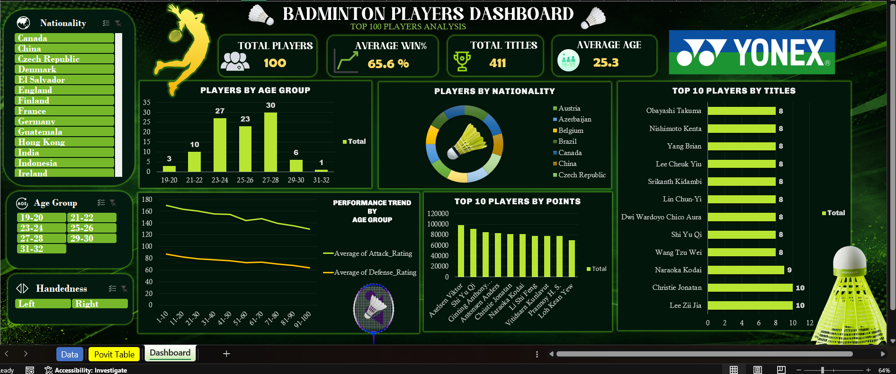

# 🏸 Badminton Players Analytics Dashboard

<p align="center">
  
</p>

<p align="center">
  <b>Interactive Excel dashboard for exploring badminton player performance, rankings, and statistics.</b>
</p>

<p align="center">
  
  
  
</p>

---

## 📊 Project Overview

The **Badminton Players Analytics Dashboard** is an interactive Excel-based sports analytics project that transforms player-level badminton statistics into clear and actionable visual insights.

The dashboard combines **PivotTables, PivotCharts, slicers, KPI cards, and data visualization** to make player analysis simple, interactive, and easy to understand.

> **Goal:** Turn raw badminton statistics into an interactive dashboard for exploring player performance and discovering patterns.

---

## 🎯 Key Metrics

| Metric | Description |
|---|---|
| 👥 **Total Players** | Number of players in the dataset |
| 🏆 **Total Titles** | Combined titles across players |
| 📈 **Average Win %** | Average player win percentage |
| 🎂 **Average Age** | Average age of players |

---

## 🔎 Dashboard Features

### 🎛️ Interactive Filters

Explore the dashboard dynamically using slicers for:

- **Nationality**
- **Age Group**
- **Handedness**
- **Playing Style** *(where available)*

### 📌 Player Analysis

The dashboard visualizes:

- Player distribution by age group
- Players by nationality
- Attack vs. defense performance
- Top players by points
- Top players by titles
- Key player performance statistics

---

## 🧰 Tools & Techniques

- **Microsoft Excel**
- PivotTables
- PivotCharts
- Slicers
- KPI Cards
- Data Cleaning
- Data Visualization
- Sports Analytics

---

## 📁 Repository Structure

```text
badminton-player-analytics-dashboard/
│
├── 📄 README.md
├── 📊 dashboard/
│   └── Badminton_Players_Dashboard.xlsx
├── 📂 data/
│   └── badminton_players.csv
└── 🖼️ images/
    └── dashboard-preview.png
```

---

## 📋 Dataset

The dataset contains structured information about **100 badminton players**, including:

- Player name
- Ranking
- Points
- Nationality
- Age
- Age group
- Handedness
- Playing style
- Win percentage
- Titles
- Career prize money
- Attack rating
- Defense rating
- Experience
- Average match duration

The dataset is intended primarily for **educational, analytical, and visualization purposes**.

---

## 🚀 How to Use

1. Download the Excel dashboard from the `dashboard/` folder.
2. Open the `.xlsx` file in Microsoft Excel.
3. Open the dashboard sheet.
4. Use the slicers to filter the player data.
5. Explore how the KPI cards and charts respond to your selections.

> **Tip:** Try different combinations of slicers to compare player groups and discover patterns.

---

## 💡 Questions You Can Explore

- Which nationalities have the most players?
- Which age group has the highest number of players?
- How does attack performance compare with defense performance?
- Which players have the highest points?
- Which players have won the most titles?
- How does performance vary across different player groups?

---

## 🏸 Learning Project

This dashboard was created as my **first class project while learning Data Science and AI/ML**.

The project helped me practice the fundamentals of **business understanding, data understanding, problem identification, data analysis, and data visualization** while learning how to turn raw data into an interactive analytical dashboard.

---

## 👨‍💻 Author

**Rishabh Chaudhary**

Data Science & AI/ML Learner

Interested in **Data Analytics, Data Science, Machine Learning, and AI**.

---

## ⭐ Support

If you find this project useful, feel free to explore the dashboard and dataset.

**If you like the project, consider giving the repository a ⭐.**

---

<p align="center">
  <i>From raw data to meaningful insights — one dashboard at a time.</i>
</p>
